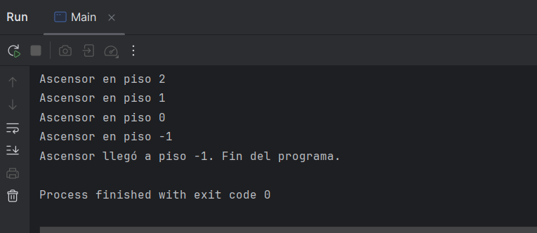

# Caso práctico 5: Programación multihilo

## Descripción

Simulación concurrente de un ascensor en Java. Un hilo representa el ascensor y varios hilos representan a los usuarios. El ascensor transporta a un solo usuario cada vez, desde su piso de origen hasta su piso de destino, atendiendo a los usuarios en orden. Cuando no quedan usuarios pendientes, baja solo hasta el piso -1 y finaliza el programa.

## Estructura del proyecto

- `Usuario.java`: hebra con un piso de origen y uno de destino. Espera a que el ascensor llegue a su piso para subir y, una vez dentro, espera a llegar a su destino para bajar.
- `Ascensor.java`: hebra que gestiona el movimiento piso a piso y, a la vez, recurso compartido con el estado del ascensor. Usa una `LinkedList<Usuario>` como cola de usuarios pendientes.
- `Main.java`: crea el ascensor y los usuarios, los registra en la cola, lanza las hebras y espera a que terminen con `join()`.

## Funcionamiento

1. Los usuarios se registran en la cola del ascensor antes de arrancar las hebras, para que el ascensor sepa cuántos hay que atender.
2. El ascensor toma al siguiente usuario de la cola, se desplaza hasta su piso de origen y le deja subir.
3. Después lo lleva a su piso de destino y le deja bajar.
4. Repite el proceso hasta que la cola queda vacía.
5. Entonces baja solo hasta el piso -1, muestra el mensaje de finalización y el programa termina.

## Sincronización

- `subir()` y `bajar()` son métodos `synchronized`. Los usuarios esperan con `wait()` hasta que el ascensor está en su piso y es su turno.
- El ascensor activa las condiciones `puedeEntrar` y `puedeSalir` y llama a `notifyAll()` para avisar a los usuarios. Después espera con `wait()` hasta que el usuario ha subido o bajado.
- Todas las esperas usan `while` y no `if`, para volver a comprobar la condición cada vez que la hebra se despierta.
- El estado compartido (piso actual, usuario en atención, cola de pendientes) solo se modifica dentro de bloques `synchronized`, lo que asegura la exclusión mutua.
- El `Thread.sleep` que simula el movimiento está fuera de los bloques `synchronized`, para no bloquear a los demás mientras el ascensor se mueve.

## Evitar bloqueos mutuos

- Cada hebra activa su condición y llama a `notifyAll()` **antes** de esperar, así nadie se queda esperando un aviso que ya pasó.
- Los usuarios se registran en la cola antes de lanzar las hebras. Si no, el ascensor podría ver la cola vacía al arrancar y terminar sin atender a nadie.
- El ascensor atiende a un único usuario cada vez, por lo que no compiten dos usuarios por entrar a la vez.

## Resultado

En la consola se ve cómo el ascensor atiende a los usuarios en orden, cada uno sube en su piso de origen y baja en su destino, y al final el ascensor baja solo hasta el piso -1 y finaliza el programa.